<div align="center">

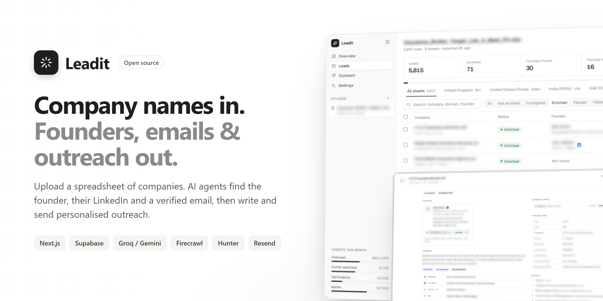

# Leadit

**The open-source lead enrichment and outreach platform.**
Upload a spreadsheet of company names. AI agents find each founder, their LinkedIn and a verified email,
then write and send personalised outreach from your own domain. Built to run on free API tiers.

[](LICENSE)
[](https://nextjs.org)
[](https://supabase.com)
[](https://www.typescriptlang.org)
[](CONTRIBUTING.md)
[](https://github.com/Charannsai/leadit/stargazers)

[Features](#-features) · [Screenshots](#-screenshots) · [Quick start](#-quick-start) · [How it works](#-how-it-works) · [Deploy](#-deploy-to-vercel) · [Roadmap](#-roadmap)

</div>

---

## Why Leadit?

Tools like Clay, Apollo and ZoomInfo charge per seat and per credit, often **hundreds of dollars a month**, to turn a list of companies into people you can actually reach. Leadit does the same job **on your own infrastructure, with your own API keys, mostly on free tiers**:

- **Company name → founder → verified email.** Most rows need no website column; Leadit finds the domain itself.
- **Then it does the outreach.** AI writes a personalised email (or LinkedIn message) for every lead from one brief. You approve them all at once, and they go out from *your* domain, inside your daily limit.
- **You own everything.** Your leads live in your Supabase project. No per-seat pricing, no credits marked up 10×, no vendor lock-in.

> 💡 From a real test run on ~70 small businesses, given **company names only**: Leadit found the website for 99%, identified a founder for 42%, and 69% of the founder emails it found passed verification, all on free tiers.

---

## ✨ Features

### Enrichment
- **Multi-sheet CSV / Excel import.** Every sheet becomes its own tab; columns are auto-detected (company, website, location), and title rows above a table are skipped.
- **Review before you spend.** All rows land in the dashboard first; you choose what to enrich.
- **Waterfall enrichment, free sources first:** sheet → Clearbit → web search for the domain; Apollo company profile; website crawl; founder from the team page or LinkedIn search results; Hunter email finder → pattern guess + verification; company inboxes as a fallback.
- **Credit-aware.** Monthly limits per provider. When one runs out, leads are **paused, not failed**, and resume exactly where they stopped. Responses are cached, so you never pay twice.
- **Background worker.** Close the tab; enrichment keeps running. Live progress, per-lead activity log, retries and rate-limit backoff.
- **Flexible export.** Pick columns, drag to reorder, filter by status, result, email quality and confidence, and save presets. Excel (one tab per sheet) or CSV.

### Outreach
- **Campaigns from one brief.** Describe the offer once; the drafting agent writes a unique email for every lead from its company description, industry, location and founder details. Attach files (decks, PDFs) to every email.
- **Review, then approve all.** Edit or rewrite any draft, then one click queues the whole batch.
- **Safe sending.** One email every N seconds, never more than your daily limit in any 24 hours, opt-out line and `List-Unsubscribe` header included. Sends through **Resend** from your verified domain.
- **Delivery tracking.** Delivered / bounced / spam status pulled from Resend. Bounced founder emails are marked invalid automatically.
- **Assisted LinkedIn, never automated.** Personalised connection notes and follow-up messages become a daily task list: open profile → copy → mark sent. Your account stays safe.
- **Per-lead outreach overview.** Every channel (founder email, company email, founder LinkedIn, company page) with its status and full message history.
- **Pause and resume drafting** at any point, and pick it up exactly where it stopped.

### Agents & control
- **Four agents:** Enrichment, Drafting, Sending and Delivery. Each shows what it's doing right now, its queue, recent work and errors.
- **Switch LLMs per agent.** Groq or Gemini, any model your key can access, chosen from a dropdown.
- **Full API breakdown.** Calls, errors, rate limits, p95 latency and tokens per service and action.
- **Bring your own keys.** Add or rotate keys in the UI without a redeploy; `.env` stays the fallback.
- **Optional password gate** for when you deploy it publicly.

---

## 📸 Screenshots

> All lead data in these screenshots is blurred.

| Overview | Leads |
|---|---|
| 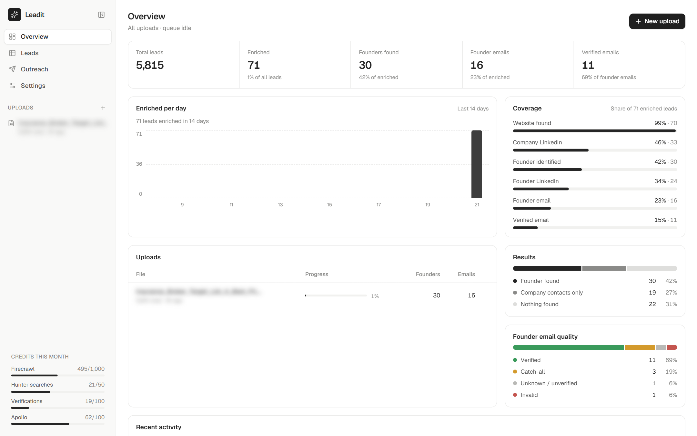 | 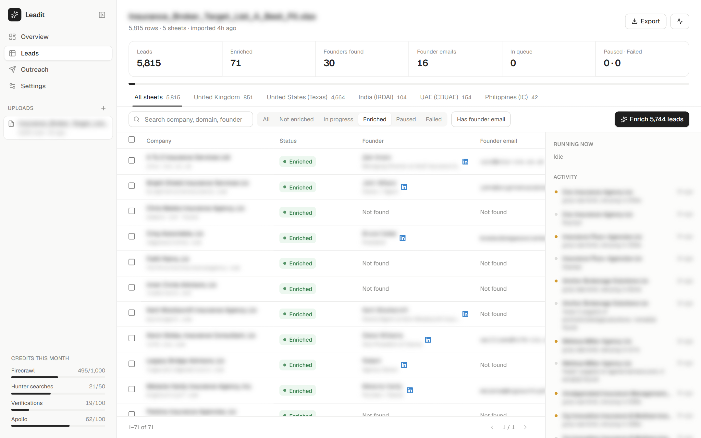 |
| **Lead profile** (full-screen view) | **Multi-sheet import** |
| 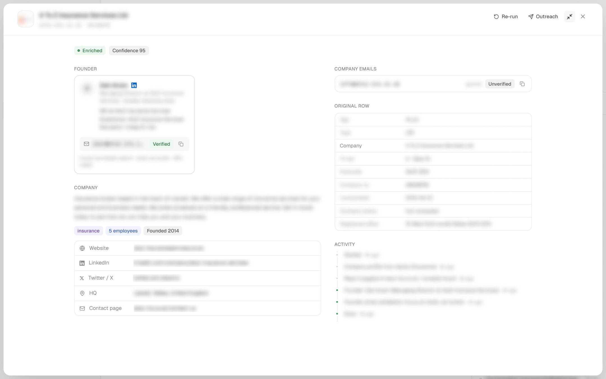 | 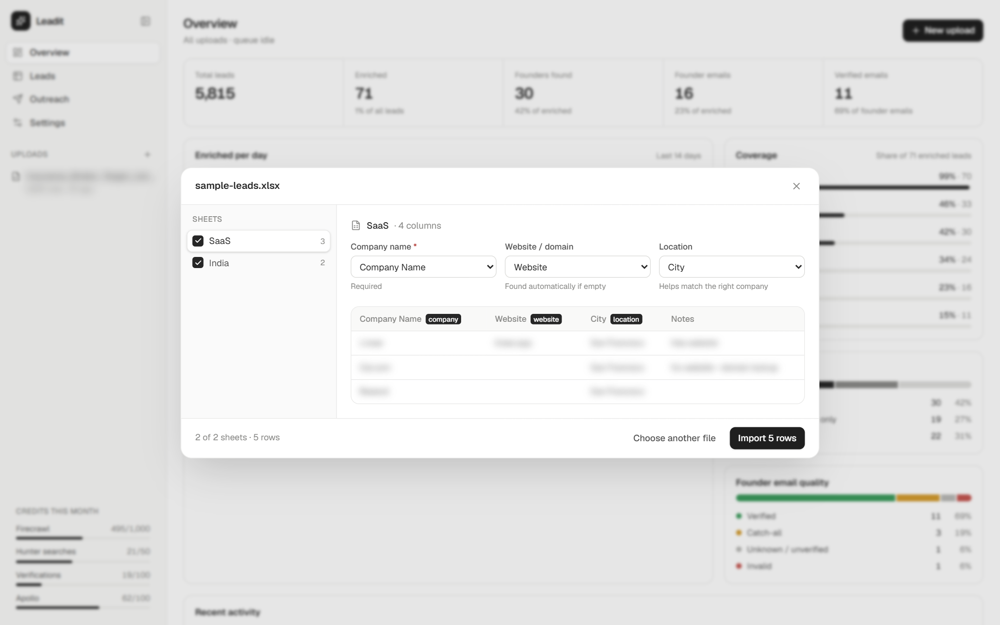 |
| **Export builder** | **Outreach overview** |
| 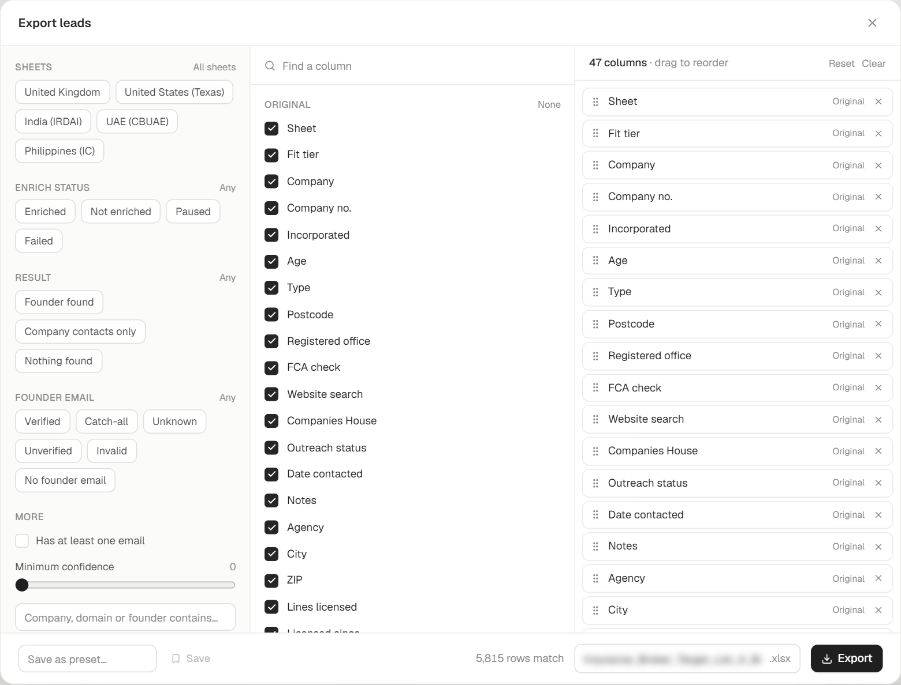 | 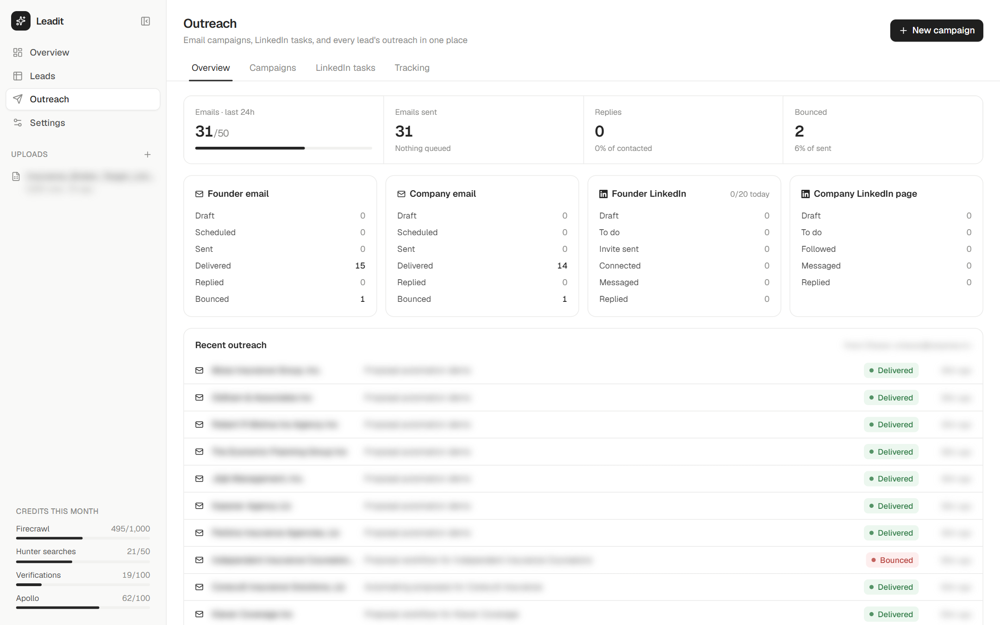 |
| **New campaign** | **Campaign review** |
| 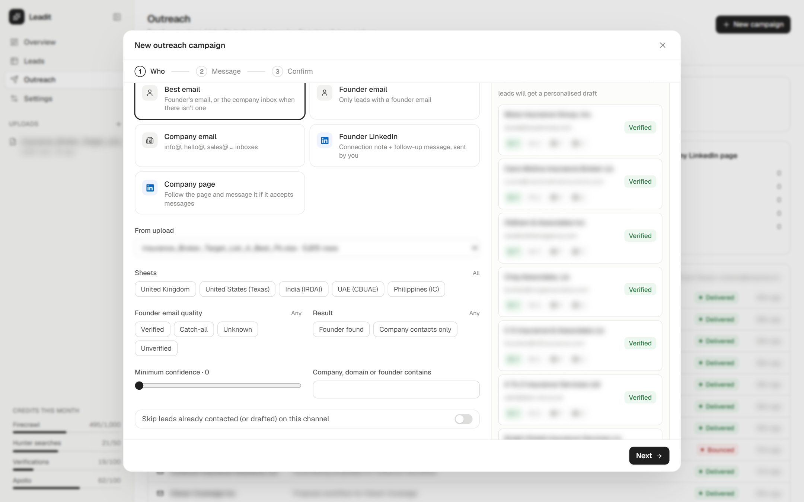 | 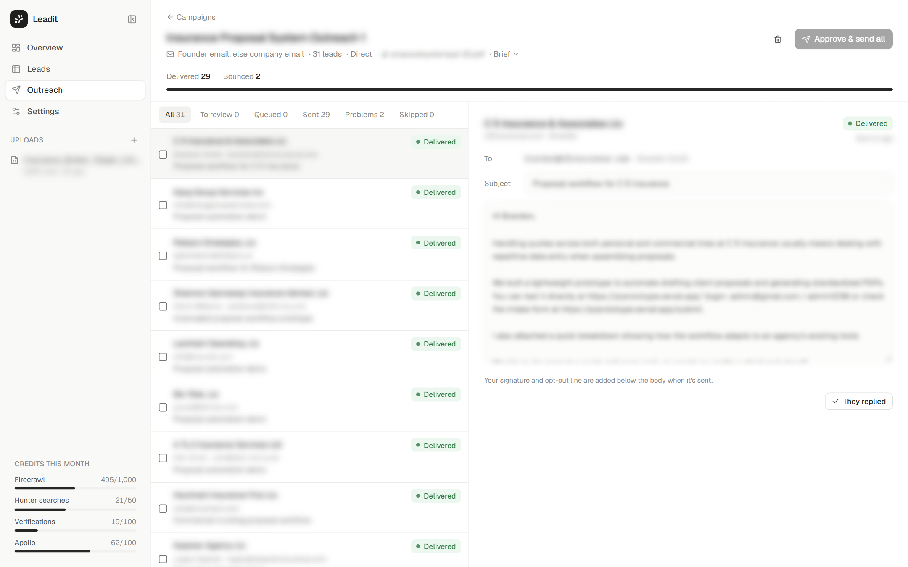 |
| **Tracking: every channel, every lead** | **Agents** |
| 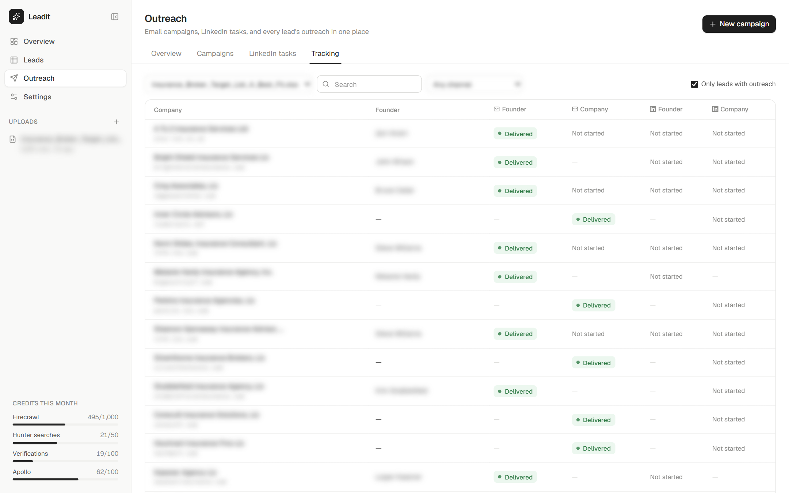 | 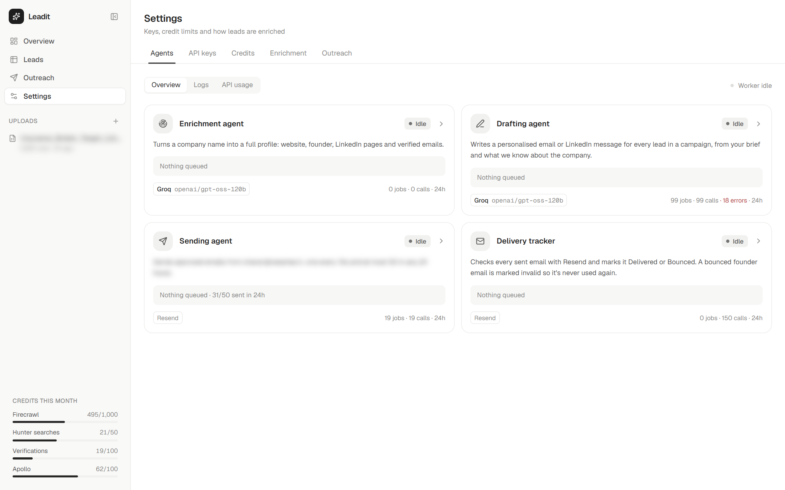 |
| **Agent detail: switch provider & model** | **Agent logs** |
| 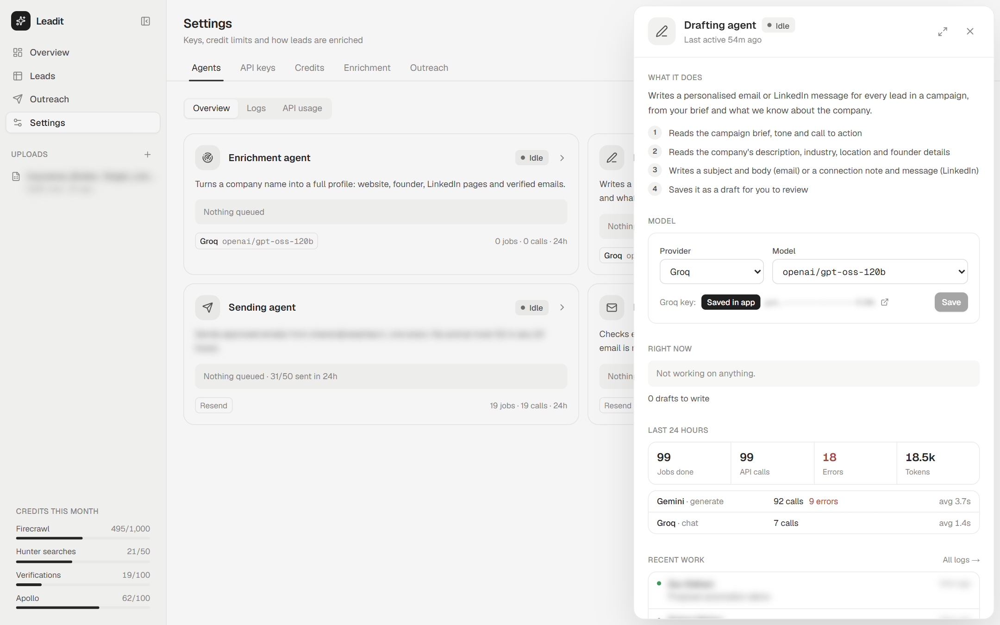 | 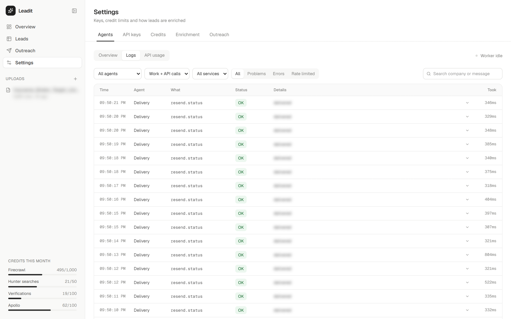 |
| **API usage** | **Bring your own keys** |
| 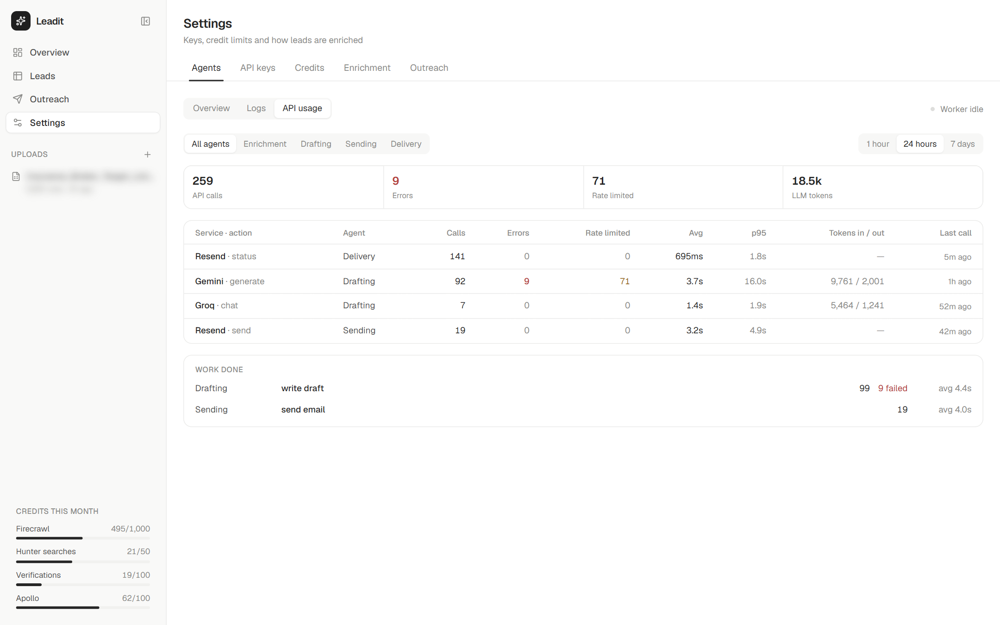 | 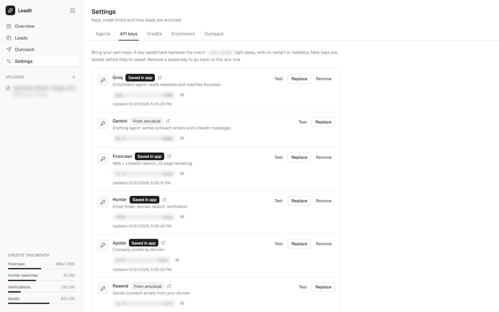 |

---

## 🚀 Quick start

### 1. Prerequisites
- Node.js 20+
- A free [Supabase](https://supabase.com) project
- API keys (all have free tiers; see [what each one is for](#-api-keys--free-tiers))

### 2. Install
```bash
git clone https://github.com/Charannsai/leadit.git
cd leadit
npm install
cp .env.example .env.local   # then fill in your keys
```

### 3. Create the database
Open Supabase → **SQL Editor**, paste [`supabase/schema.sql`](supabase/schema.sql) and run it once.
Every table is prefixed `le_`, so it's safe in a project you already use for something else.

> Upgrading an older install? Run the numbered files in `supabase/` that you haven't run yet, in order.

### 4. Run
```bash
npm run dev      # development, http://localhost:3000
npm run prod     # build + start, fastest for daily use
```

Try it with the bundled [`samples/sample-leads.xlsx`](samples/sample-leads.xlsx): two sheets, a title row, and some companies with no website.

---

## 🔑 API keys & free tiers

| Service | Used for | Free tier (approx.) | Needed? |
|---|---|---|---|
| [Supabase](https://supabase.com) | Database, attachment storage | 500 MB DB | **Required** |
| [Groq](https://console.groq.com) | Enrichment agent (reads sites, matches founders) | Generous, rate-limited | **Required** (or Gemini) |
| [Gemini](https://aistudio.google.com) | Drafting agent (writes outreach) | Free tier available | For outreach (or Groq) |
| [Firecrawl](https://firecrawl.dev) | Web + LinkedIn search, JS rendering | 500–1,000 credits | Recommended |
| [Hunter](https://hunter.io) | Email finder, domain search, verification | 25–50 searches, 50–100 verifications / mo | Recommended |
| [Apollo](https://apollo.io) | Company profile by domain | Small monthly credits | Optional |
| [Resend](https://resend.com) | Sending outreach email | 100 emails / day | For outreach |
| Clearbit autocomplete | Company name → domain | Free, no key | Built in |

Free tiers change, so check each provider's pricing page. Leadit tracks usage against limits you set in **Settings → Credits**.

---

## 🧠 How it works

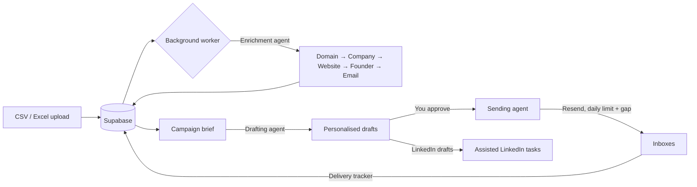

**Enrichment waterfall.** Each step saves as it finishes, so a paused or retried lead never pays twice:

| Step | Free first | Paid fallback |
|---|---|---|
| Website domain | Sheet column, URLs/emails in the row, Clearbit | Firecrawl search + LLM picks the right result |
| Company profile | — | Apollo organization enrich |
| Website crawl | Plain fetch of home + about/team/contact | Firecrawl scrape for JS-only sites |
| Founder | Team page read by the LLM | LinkedIn search results + LLM match check |
| Founder email | Website / snippet emails | Hunter finder → pattern guess + verify |
| Company contacts | Website emails | Hunter domain search |

LinkedIn is **never scraped or automated**. Profile URLs come from public search results, and LinkedIn outreach is done by you, assisted by the app.

**The worker.** `/api/worker` answers immediately and processes the queue in the background (`after()`). It hands over to a new run before Vercel's time limit, keeps one run active at a time with a lock in Postgres, and restarts itself from any page if it ever stops with work waiting.

<details>
<summary><b>Project structure</b></summary>

```
src/
  app/
    (app)/            Overview, Leads, Outreach, Settings pages
    api/              Route handlers: uploads, leads, worker, export, outreach, agents, keys…
  components/         UI (tables, drawers, export builder, campaign wizard, agents tab…)
  lib/
    pipeline/         Enrichment steps
    outreach/         Drafting, scheduling, sending, delivery sync
    providers/        Groq, Gemini, Firecrawl, Hunter, Apollo, Clearbit, website crawler
    agentLog.ts       Per-call logging for the Agents tab
    worker.ts         Queue runner
supabase/             SQL schema + migrations
```
</details>

---

## ▲ Deploy to Vercel

[](https://vercel.com/new/clone?repository-url=https%3A%2F%2Fgithub.com%2FCharannsai%2Fleadit&env=SUPABASE_URL,SUPABASE_SERVICE_ROLE_KEY,GROQ_API_KEY,WORKER_SECRET,APP_PASSWORD&envDescription=Supabase%20and%20at%20least%20one%20LLM%20key%20are%20required.%20Set%20APP_PASSWORD%20so%20your%20dashboard%20is%20protected.&envLink=https%3A%2F%2Fgithub.com%2FCharannsai%2Fleadit%2Fblob%2Fmain%2F.env.example)

1. Add every variable from [`.env.example`](.env.example) in Vercel.
2. **Set `APP_PASSWORD`.** Without it anyone with the URL can see your leads.
3. Set `CRON_SECRET`; [`vercel.json`](vercel.json) runs the worker daily so queued emails go out even when nobody has the app open.
4. The worker uses `maxDuration = 300` (Fluid Compute, on by default for new projects).

---

## 🛡 Responsible use

Leadit is a tool for **relevant, low-volume B2B outreach**. You're responsible for complying with the laws that apply to you and your recipients (GDPR, UK PECR, CAN-SPAM…) and with each provider's terms. Defaults are conservative on purpose: daily limits, spacing between emails, an opt-out line, and no LinkedIn automation.

---

## 🗺 Roadmap

- [ ] Reply detection from your inbox (IMAP / Gmail / Zoho), with AI classification: interested, question, not now, unsubscribe
- [ ] Follow-up sequences in the same thread that stop on reply
- [ ] Reply inbox with AI-suggested answers
- [ ] Do-not-contact list
- [ ] CRM export (HubSpot, Pipedrive)
- [ ] More providers (OpenAI, Anthropic, local models; Snov, Dropcontact)
- [ ] Team accounts

Have an idea? [Open a feature request](https://github.com/Charannsai/leadit/issues/new?template=feature_request.yml).

---

## 🤝 Contributing

Contributions are very welcome. Read [CONTRIBUTING.md](CONTRIBUTING.md) to get set up; good first issues are labelled [`good first issue`](https://github.com/Charannsai/leadit/labels/good%20first%20issue).
Please follow our [Code of Conduct](CODE_OF_CONDUCT.md) and report vulnerabilities privately as described in [SECURITY.md](SECURITY.md).

If Leadit saves you a Clay subscription, **a ⭐ helps others find it.**

[](https://star-history.com/#Charannsai/leadit&Date)

---

## License

[MIT](LICENSE) © Charannsai and contributors
